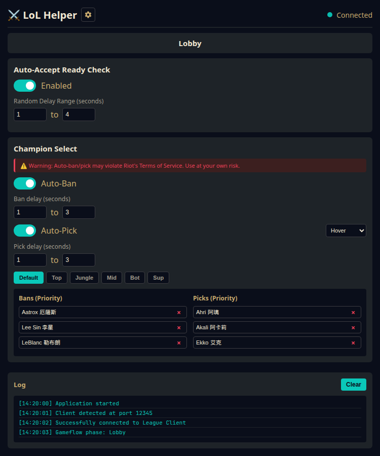

# League of Legends Auto-Accept Helper

A lightweight Windows desktop helper that automatically accepts League of Legends matchmaking ready checks and provides champion select automation using the League Client Update (LCU) API.

## Features

### 🎨 Desktop UI (v0.3.0+)



- **Dark, League-inspired UI** built with pywebview (WebView2 backend)
- **Real-time status display**: connection state, gameflow phase
- **Live settings**: toggle features and adjust settings without restart
- **Champion select automation**: per-role ban/pick preferences
- **Live log view**: monitor what's happening in real-time
- **Minimal memory footprint**: window closes to tray, releasing WebView2 processes

### ⚡ Core Features

#### Auto-Accept (v0.2.0+)
- **Auto-accepts ready checks** instantly using the official League Client local API
- **Real-time WebSocket connection** for instant response (with HTTP polling fallback)
- **Configurable random delay** - add 1-4s random delay to avoid appearing robotic

#### Champion Select (v0.3.0+)
- **Auto-ban champions** - configure up to 3 ban champions per role with priority fallback
- **Auto-pick/hover champions** - configure up to 3 pick champions per role with priority fallback
- **Per-role preferences** - different settings for Top, Jungle, Mid, Bot, Support, and Default (blind pick)
- **Smart filtering** - skips banned/picked champions and teammate intents
- **PLANNING phase hover** - automatically hovers your top pick during planning phase
- **Hover or Lock mode** - choose whether to just hover or instantly lock your pick
- **⚠️ Warning**: Auto-ban/pick features may violate Riot's Terms of Service. Use at your own risk.

#### General
- **Automatic client detection** via lockfile or running process
- **Handles client restarts** - automatically reconnects when the client restarts
- **System tray integration** - runs quietly in the background with status indicators
- **Easy to use** - just double-click and go!

## Download

Download the latest version from [Releases](../../releases). Get the `LoLAutoAccept-vX.X.X-win64.zip` file.

## Requirements

- **Windows 10/11**
- **Microsoft Edge WebView2 Runtime** (usually pre-installed on Windows 10/11)
  - If missing, you'll see a message with download link on first run
  - App will still work from tray without the UI
  - Download from: https://developer.microsoft.com/microsoft-edge/webview2/

## Installation & Usage

1. **Download** the ZIP file (e.g., `LoLAutoAccept-v0.2.0-win64.zip`) from the [Releases](../../releases) page
2. **Extract** the ZIP to a dedicated folder (right-click → Extract All...)
3. **Run** `LoLAutoAccept.exe` by double-clicking it
4. A `config.yaml` file will be created on first run in the same folder
5. A window opens showing connection status and settings
6. **Wait** for the League Client to open (or open it after starting the helper)
7. The helper will automatically connect and start accepting ready checks

### Using the UI

The UI shows:
- **Connection status** (disconnected / connecting / connected)
- **Gameflow phase** (Lobby / In Queue / Ready Check / Champ Select / In Game)
- **Auto-accept toggle** - turn on/off instantly
- **Delay controls** - adjust min/max random delay (0-10 seconds)
- **Champion select settings**:
  - Auto-ban and auto-pick toggles
  - Hover/Lock mode selector
  - Per-role champion preferences (Top, Jungle, Mid, Bot, Support, Default)
  - Up to 3 ban and 3 pick champions per role in priority order
- **Live log** - see what's happening in real-time

#### Champion Select Setup

1. **Enable auto-ban/auto-pick** using the toggles
2. **Select pick mode**: "Hover" (safer) or "Lock" (auto-locks)
3. **Choose your role** using the role tabs
4. **Set champions** for each priority slot (1st, 2nd, 3rd)
   - Bans: Champions you want to ban (priority order for fallback)
   - Picks: Champions you want to pick/hover (priority order for fallback)
5. **Repeat for each role** you play

The app will automatically:
- Use the correct preferences based on your assigned position
- Fall back to next priority if a champion is banned/picked
- Skip teammate hover/intent champions when banning
- Use "Default" preferences for blind pick (no assigned position)

### System Tray

Once running, you'll see an icon in your system tray (bottom-right of Windows taskbar). 

**Closing the window (X button)** hides to tray and **destroys the UI window** to free memory (WebView2 processes exit). The core keeps running in the background.

Right-click the tray icon to:
- **Open** - reopen the UI window
- **Toggle Auto-Accept** - turn on/off from tray
- **Quit** - exit completely

**Note**: When minimized to tray, the app uses ~30-50 MB RAM. With the UI window open, it uses ~80-120 MB due to WebView2 overhead.

### Configuration

On first run, a `config.yaml` file is created in the same folder as the executable. You can edit it to customize behavior:

```yaml
# Enable or disable auto-accept feature
auto_accept_enabled: true

# Random delay range before accepting (in seconds)
# The actual delay will be randomly chosen between min and max for each ready check
# This helps avoid appearing robotic and gives you time to manually decline if desired
accept_delay_min_seconds: 1
accept_delay_max_seconds: 4

# UI Settings (v0.2.0+)
start_minimized: false  # false = open window on start, true = start in tray only

# Legacy config (backward compatible):
# If you prefer a fixed delay, uncomment this line and comment out the min/max above:
# accept_delay_seconds: 2

# Logging level (DEBUG, INFO, WARNING, ERROR)
log_level: INFO
```

**Config Options:**

- `auto_accept_enabled`: Turn auto-accept on/off (default: `true`)
- `accept_delay_min_seconds` / `accept_delay_max_seconds`: Random delay range before accepting (default: 1-4 seconds). Each ready check gets a new random delay in this range.
- `start_minimized`: Start in tray without opening the window (default: `false`)
- `accept_delay_seconds`: (Legacy) Fixed delay before accepting. If present, overrides min/max settings.
- `log_level`: Logging verbosity - `DEBUG`, `INFO`, `WARNING`, or `ERROR` (default: `INFO`)

**Why random delay?**
- Avoids appearing robotic (instant accepts look suspicious)
- Gives you 1-4 seconds to manually decline if you change your mind
- Makes timing less predictable

**Note (v0.2.0+)**: You can change most settings directly in the UI window! Changes apply immediately and are saved to `config.yaml`.

## Windows SmartScreen Notice

Since this is an unsigned executable, Windows SmartScreen may show a warning when you first run it:

1. Click "More info"
2. Click "Run anyway"

This is normal for any unsigned Windows application. If you're concerned, you can check the source code in this repository and build it yourself (see Development section below).

## How It Works

The helper uses the League Client's built-in local API:

1. **Finds the client** by reading the `lockfile` or detecting the running `LeagueClientUx.exe` process
2. **Authenticates** using the client's local credentials (Basic auth with `riot:<password>`)
3. **Connects via WebSocket** to receive real-time events
4. **Listens for events**:
   - Ready checks: `OnJsonApiEvent_lol-matchmaking_v1_ready-check`
   - Champion select: `OnJsonApiEvent_lol-champ-select_v1_session`
5. **Takes actions** automatically based on your configuration:
   - Accepts ready checks when detected
   - Bans/picks champions during champion select based on your role

All communication happens locally on your computer (`127.0.0.1`) - nothing is sent over the internet.

## Development

### Prerequisites

- Python 3.9 or higher
- Windows OS (for testing with actual League Client)

### Setup

```bash
# Clone the repository
git clone <your-repo-url>
cd <repo-name>

# Install dependencies
pip install -r requirements-dev.txt

# Run tests
pytest tests/ -v

# Run the application
python main.py
```

### Building

To build the executable yourself:

```bash
# Build with PyInstaller
pyinstaller build.spec

# The executable will be in dist/LoLAutoAccept.exe
```

### Project Structure

```
.
├── lcu/                    # League Client API integration
│   ├── client_finder.py    # Find and authenticate with client
│   ├── api_client.py       # HTTP API wrapper
│   └── websocket_client.py # WebSocket event streaming
├── core/
│   ├── app_controller.py   # Main application controller
│   └── event_bus.py        # Event dispatching system
├── features/               # Modular features
│   ├── base_feature.py     # Base feature class
│   ├── auto_accept.py      # Auto-accept implementation
│   ├── champ_select.py     # Champion select automation (v0.3.0+)
│   └── champ_select_logic.py # Testable champion select logic (v0.3.0+)
├── ui/                     # WebView-based UI
│   ├── index.html          # UI structure
│   ├── style.css           # UI styling
│   └── app.js              # UI logic
├── tests/                  # Unit tests
├── main_ui.py              # Application entry point (UI mode)
├── config.yaml             # Configuration file
└── build.spec              # PyInstaller build configuration
```

## Troubleshooting

### "Waiting for League Client..."

The helper can't find your League Client. Make sure:

- League of Legends is running
- The client is fully loaded (not just the launcher)
- You have appropriate permissions to read process information

### "Connection failed, retrying..."

The helper found the client but can't connect. Try:

- Restarting the League Client
- Restarting the helper
- Checking if antivirus/firewall is blocking local connections

### Ready checks aren't being accepted

- Check that auto-accept is enabled (right-click system tray icon or check UI)
- Check the log output for errors
- Try setting `log_level: DEBUG` in `config.yaml` for more detailed logs

### Champion select isn't working

- Check that auto-ban/auto-pick is enabled in the UI
- Make sure you've configured champions for your role
- Check the log for "Champion select" messages
- Champion IDs are loaded from the client on connect - make sure you're connected
- Some game modes (ARAM, special modes) may not support all features

## Disclaimer

⚠️ **Important**: This tool uses the League Client's local API, which is not officially documented or supported by Riot Games. Use at your own risk.

- This tool does **not** modify game files or memory
- This tool does **not** provide any competitive advantage in-game
- Auto-accept only automates clicking the "Accept" button during matchmaking
- **Auto-ban and auto-pick features may be considered automation of gameplay actions**, which could potentially violate Riot's Terms of Service
- Riot Games may change their API at any time, which could break this tool
- **The champion select features are experimental** - use at your own discretion

The developers are not responsible for any consequences of using this tool, including but not limited to account restrictions or bans.

## License

MIT License - see LICENSE file for details

---

# 簡介 (Traditional Chinese)

League of Legends 自動接受對戰工具，使用英雄聯盟客戶端的本地 API 自動接受配對準備檢查。

## 主要功能

- **自動接受準備檢查** - 使用官方客戶端本地 API 即時回應
- **即時 WebSocket 連接** - 無延遲響應
- **自動偵測客戶端** - 透過 lockfile 或執行中的程序
- **自動重新連接** - 當客戶端重新啟動時自動重連
- **可設定延遲** - 可選擇延遲接受時間
- **系統托盤圖示** - 在背景安靜執行並顯示狀態

## 下載與使用

1. 從 [Releases](../../releases) 下載 `LoLAutoAccept.exe`
2. 雙擊執行檔案
3. 開啟英雄聯盟客戶端
4. 工具會自動連接並開始接受配對

## 配置檔案

首次執行會自動建立 `config.yaml` 設定檔，可編輯自訂行為：

- `auto_accept_enabled`: 啟用/停用自動接受功能
- `accept_delay_seconds`: 延遲接受秒數（0 表示立即）
- `log_level`: 記錄等級（DEBUG, INFO, WARNING, ERROR）

## Windows SmartScreen 提示

由於這是未簽署的執行檔，Windows SmartScreen 可能會顯示警告：

1. 點擊「更多資訊」
2. 點擊「仍要執行」

這對任何未簽署的 Windows 應用程式都是正常的。如有疑慮，您可以檢查本儲存庫的原始碼並自行編譯。

## 免責聲明

⚠️ **重要**：本工具使用英雄聯盟客戶端的本地 API，這不是 Riot Games 官方支援的功能。使用風險自負。

- 本工具**不會**修改遊戲檔案或記憶體
- 本工具**不會**提供任何競技優勢
- 本工具僅自動化配對時點擊「接受」按鈕的動作
- Riot Games 可能隨時變更其 API，導致本工具無法使用

開發者不對使用本工具的任何後果負責，包括但不限於帳號限制或封禁。
